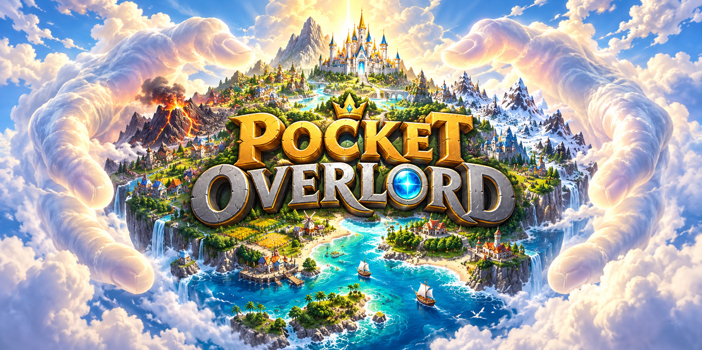

# 🌍 Pocket Overlord

> **A living pixel world in your hands.**
>
> Populate an island, watch families build villages, guide them through the seasons, or reshape their home with rain and explosions.

[Overview](#-overview) · [Powers](#-powers) · [Civilizations](#-civilizations) · [Changelog](CHANGELOG.md)

---

## 📖 Overview

**Pocket Overlord** is a browser sandbox about small worlds and the people who inhabit them. Place the first settlers and watch them build homes, raise families, grow food and connect their villages with roads.

Every settlement has its own story. Neighbors share supplies, form alliances, fight wars and search for safer places to live. The seasons change what they can harvest and how much food they need. Your tools can help them recover—or leave them rebuilding after a disaster.

Pause to place people and plan your next move, then let the world continue at your chosen speed.

---

## ✨ Powers

Four tools let you bring life, restore the land and cause destruction.

### 👥 People

- **Human:** Place settlers on open land. Nearby adults form communities, build homes and start families.
- **Independent lives:** Residents find food, work the fields, repair roads and take part in village life without individual orders.

### 🌧️ Nature

- **Rain:** Hold the mouse button to water the ground, put out fires and help scorched land recover.
- **Regrowth:** Craters gradually close and grass or sand returns. A new explosion starts recovery again.

### 💥 Destruction

- **Dynamite:** Place an explosive with a two-second fuse. Nearby explosives can trigger chain reactions.
- **Rocket:** Choose a target for a stronger strike from above.
- **Lasting damage:** Blasts destroy buildings, leave craters and break roads. Fire spreads through trees and settlements; surviving residents repair damaged road sections.

---

## 🏘️ Civilizations

- **Homes and families:** Adults pair up, move into homes and raise children. Family ties continue as children grow up and establish households of their own.
- **Farming and food:** Villagers cultivate fields, harvest crops and store food. Rain helps crops grow; hunger threatens settlements when supplies run out.
- **Roads and caravans:** Roads connect villages and make travel faster. Caravans carry food between allied settlements.
- **Alliances and wars:** Villages cooperate or become rivals. Allies join shared campaigns, armies gather before marching, and losses or shortages can bring a truce.
- **Family migration:** Hunger, housing shortages or war can send families toward a peaceful village with food and space. Parents and children travel together with supplies.
- **New settlements:** Prosperous villages can send pioneers to fertile land. They build their new homes after arriving and become part of the island's village life.
- **World chronicle:** Follow village populations, food stocks, alliances, campaigns and events in the settlement panel.

---

## 🍂 Seasons

A year passes through **spring, summer, autumn and winter**. Each season lasts one minute of game time; pausing also pauses the calendar.

| Season | Life on the island |
| --- | --- |
| Spring | Fields grow at their normal pace. |
| Summer | Crops grow faster. |
| Autumn | Harvests provide more food, helping villages prepare for winter. |
| Winter | Harvesting stops and hunger increases. Villages rely on stored food and keep a reserve for their residents. |

The world overview shows the current season, year and food reserves. Pioneers wait until winter is over before setting out to found a new settlement.

---

## ⏱️ World and time

- **World shapes:** Choose **Turtle**, **Phoenix**, **Kraken**, **Whale**, **Yin and Yang** or a random shape when creating a new world.
- **Pause and resume:** Inspect the island or place tools while time is stopped. Timers, travel and explosions continue when you resume.
- **Speed selection:** Choose **⅕×, 1×, 2×, 4×, 10× or 20×** from the speed menu. The speed reached depends on the activity in the world and your device.
- **Camera:** Zoom in to watch individual villagers, or pull back to follow the whole island.
- **New world:** Open **Settings → New world**, choose a shape and confirm. This replaces your current world.

The game pauses when its browser tab is hidden and continues when you return.
